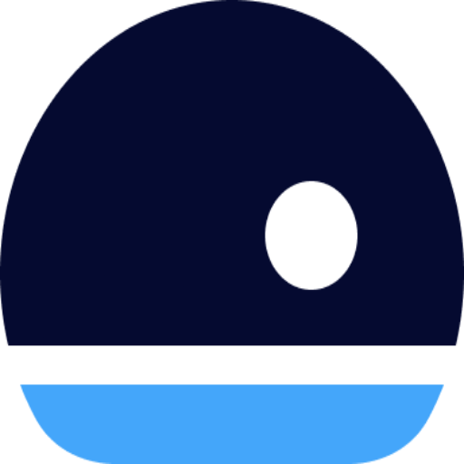
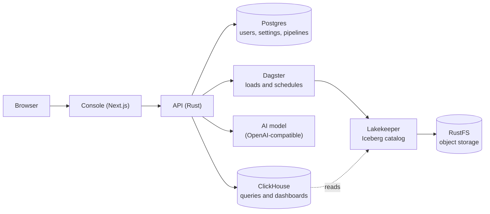

<p align="center">
  <picture>
    <source media="(prefers-color-scheme: dark)" srcset="public/logo-dark.png">
    <source media="(prefers-color-scheme: light)" srcset="public/logo-light.png">
    
  </picture>
</p>

<h1 align="center">RantAI Lakehouse</h1>

<p align="center">
  A lakehouse with dashboards and an AI assistant built in.
</p>

RantAI Lakehouse is one product for your data and your reports. It loads
data from your systems, stores it in open Iceberg tables, transforms and
queries it, and builds dashboards on top. There's no separate BI tool to buy.
An AI assistant can do most of this for you, and it waits for a person to
approve anything risky.

It runs on your own Linux server with Docker.

## What you can do with it

- **Load data** from databases (with live change capture), files, APIs and
  business apps such as Salesforce or HubSpot.
- **Store it** in open Iceberg tables, in Bronze, Silver and Gold layers.
- **Transform it** with scheduled pipelines.
- **Query it** in Query Studio, in SQL or in plain language.
- **Build dashboards**: charts, filters, sharing, embedding, alerts, and
  PDF, Excel and scheduled email reports.
- **Ask the assistant** to answer a question, build a chart or run a
  pipeline.
- **Control access**: roles, tenants, masking, row filters, audit log and
  single sign-on.

What's built and what's missing: [docs/core/PRODUCT.md](docs/core/PRODUCT.md).

## Install

### What you need

| | Minimum |
| --- | --- |
| Operating system | Linux on x86_64 (arm64 is not supported yet) |
| Docker | Docker Engine 24 or newer, with the Compose plugin 2.24 or newer |
| CPU | 4 cores |
| Memory | 16 GB |
| Free disk | 50 GB |
| Tools | `curl` and `sha256sum` |

The installer checks all of these first and stops with what to fix if one
is missing.

### Install with one command

Run this as a user who can use Docker and write to `/opt`, for example
`root`:

```bash
curl -fsSL https://get.rantai.dev/lakehouse | bash
```

This installs the newest release. To pick a version, add
`-s -- --version 0.2.1` after `bash`.

The installer:

1. Downloads the `lakehousectl` tool and checks its checksum.
2. Verifies the release's signature.
3. Checks your server against the minimums above.
4. Writes everything into `/opt/rantai-lakehouse`, including an `.env` with
   a generated value for every secret.
5. Pulls the images and starts the stack.
6. Waits until it is ready.

It ends by printing the console's address and the first administrator's
sign-in:

```text
lakehousectl: the console is at http://<this host>:3000
lakehousectl: the first administrator is admin (email admin@example.com).
lakehousectl: its password is shown once, and it must be changed at first
lakehousectl: sign-in:
  <generated password>
```

Open that address, sign in with `admin` (or `admin@example.com`), and set a new password. **Copy the password
before you close the terminal: it is shown only once.**

To install somewhere else, add `--dir <path>`. To skip one of the checks,
add `--ignore-preflight <check>`. The checks are `os`, `docker`,
`compose`, `cpu`, `memory`, `disk`, `ports` and `image-store`.

### Install without internet (air-gapped)

Each release also comes as an offline bundle, split into parts. On a
machine with internet:

```bash
version=0.2.1
gh release download "v$version" --repo RantAI-dev/RantAI-Lakehouse
sha256sum -c SHA256SUMS
bundle="rantai-lakehouse-$version-linux-x86_64.tar.zst"
cat "$bundle".part-* > "$bundle"
sha256sum -c "$bundle.sha256"
```

Copy `$bundle` to the server, then:

```bash
mkdir bundle && tar --zstd -xf "$bundle" -C bundle
./bundle/lakehousectl install --bundle bundle
```

An offline install needs Docker's containerd image store. The installer
checks for it. Details are in
[docs/OPERATIONS.md](docs/OPERATIONS.md#the-offline-bundle-is-published-in-parts).

## Turn on optional features

The core runs right after install. These features need a setting first.
Edit `/opt/rantai-lakehouse/.env`, then restart the services named in the
linked section.

| Feature | What to set |
| --- | --- |
| AI assistant and plain-language queries | An OpenAI-compatible model: `LLM_URL`, `LLM_MODEL`, `LLM_KEY` |
| Dashboard PDF export | `CONSOLE_INTERNAL_URL=http://console:3000` (the secret it also needs is already generated) |
| Email: alerts, digests and scheduled reports | `SMTP_HOST` and the other `SMTP_*` settings; `CONSOLE_PUBLIC_URL` for the link in a report |
| Single sign-on | Set in the console under **Settings → Sign-in**, or in `/opt/rantai-lakehouse/.env` with `OIDC_ISSUER`, `OIDC_CLIENT_ID` and the sign-in URLs |
| Signed dashboard embeds | `EMBED_SECRET` |

Each one is explained in [docs/OPERATIONS.md](docs/OPERATIONS.md), "Features
unavailable in the local stack". Every setting is listed in
[docs/CONFIGURATION.md](docs/CONFIGURATION.md).

## Keep it running

The installer does not leave `lakehousectl` on the server. Download it once
from the release, check it against `SHA256SUMS` from the same release, and put
it on your `PATH`. After that, `lakehousectl self-update` keeps it current.

| Task | Command |
| --- | --- |
| See what is running, the version and the backups | `lakehousectl status` |
| Update to the newest release (takes a backup first, rolls back by itself if the update fails) | `lakehousectl update` |
| Go back to the previous release | `lakehousectl rollback` |
| Back up now | `lakehousectl backup` |
| Restore a backup | `lakehousectl restore <backup directory>` |

Offline, add `--bundle <dir>` to `update`. The stack stops during an update.
Backups and restore are explained in [docs/OPERATIONS.md](docs/OPERATIONS.md).

## Run from source (developers)

To work on the code, or to try it without a release:

```bash
git clone https://github.com/RantAI-dev/RantAI-Lakehouse.git
cd RantAI-Lakehouse
sh ops/init-env.sh              # writes .env with generated secrets
$EDITOR .env                    # set AUTH_BOOTSTRAP_EMAIL
scripts/compose.sh up --build   # the console is on http://localhost:3000
```

Running the console and API on your machine, tests, and the frontend's
conventions: [docs/DEVELOPMENT.md](docs/DEVELOPMENT.md).

## How it fits together



More detail: [docs/ARCHITECTURE.md](docs/ARCHITECTURE.md).

## Before you rely on it

- **One server.** No multi-server setup yet, and no zero-downtime updates.
- **Not yet accepted.** Features are built and tested in CI, but the product
  owner has not yet formally accepted them.
- **AI-written code.** Most of the code was written and reviewed by AI agents,
  and it has had no full human security review. Read
  [SECURITY.md](SECURITY.md) before production use. It also covers an old
  key that is still in the git history.
- **The AI features need a model.** Without one, the assistant is off.

What the product does not do: [docs/core/PRODUCT.md](docs/core/PRODUCT.md),
section 3. Older technical notes:
[docs/KNOWN-LIMITATIONS.md](docs/KNOWN-LIMITATIONS.md).

## Documentation

| To... | Read |
| --- | --- |
| Run and operate a deployment | [docs/OPERATIONS.md](docs/OPERATIONS.md) |
| Look up a setting | [docs/CONFIGURATION.md](docs/CONFIGURATION.md) |
| Understand the design | [docs/ARCHITECTURE.md](docs/ARCHITECTURE.md), [docs/adr/](docs/adr/) |
| See what's built and what's next | [docs/core/PRODUCT.md](docs/core/PRODUCT.md), [docs/core/BACKLOG.md](docs/core/BACKLOG.md) |
| Develop | [docs/DEVELOPMENT.md](docs/DEVELOPMENT.md), [docs/CODE-STANDARD.md](docs/CODE-STANDARD.md) |
| See what changed | [CHANGELOG.md](CHANGELOG.md) |

## Contributing

See [CONTRIBUTING.md](CONTRIBUTING.md). To report a vulnerability privately,
see [SECURITY.md](SECURITY.md).

## License

AGPL-3.0-or-later. See [LICENSE](LICENSE) and [NOTICE](NOTICE). `v0.1.0` was
released under Apache-2.0, and the project moved to AGPL-3.0-or-later after
that ([CHANGELOG.md](CHANGELOG.md)).
