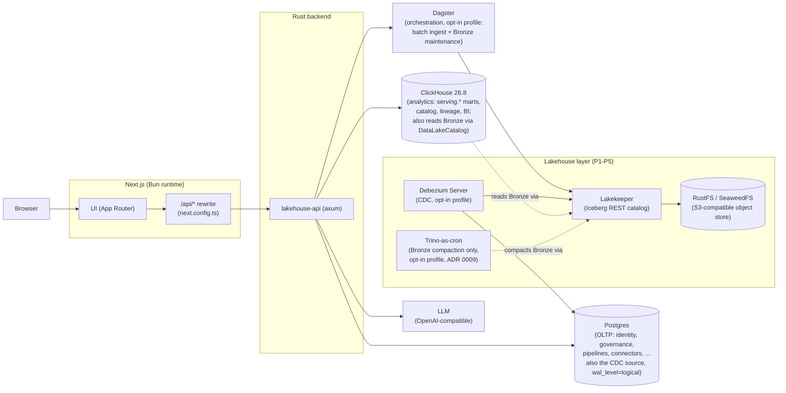

<p align="center">
  <picture>
    <source media="(prefers-color-scheme: dark)" srcset="public/logo-dark.png">
    <source media="(prefers-color-scheme: light)" srcset="public/logo-light.png">
    
  </picture>
</p>

<h1 align="center">RantAI Lakehouse</h1>

<p align="center">
  A data-lakehouse console for browsing a catalog, running pipelines,
  building dashboards, and chatting with an LLM over your data.
</p>

RantAI Lakehouse is a data-lakehouse console: a web UI for browsing a data
catalog, running and scheduling pipelines, building dashboards, managing
governance policies, and chatting with an LLM over your data. It's a
Next.js/React frontend backed by a Rust (axum) API that talks to Postgres,
ClickHouse, Dagster, and an OpenAI-compatible LLM.

The backend was originally written in TypeScript (as Next.js API routes)
and has since been fully ported to Rust; see "Status / Known limitations"
below and [docs/ARCHITECTURE.md](docs/ARCHITECTURE.md) for what that means
in practice.

## Architecture



See [docs/ARCHITECTURE.md](docs/ARCHITECTURE.md) for the full module map (14
Rust crates), the request lifecycle (browser → rewrite → axum middleware →
policy check → handler → store/client), and the Postgres-vs-ClickHouse data
model.

The lakehouse layer (Lakekeeper, RustFS/SeaweedFS, Debezium, Trino) is real
infrastructure, verified end to end (see `docs/plans/G1-RESULT.md` through
`docs/plans/P5-RESULT.md`), and is compose-profile opt-in for the
Dagster/Trino pieces (`dagster`, `trino`). **`lakehouse-iceberg` now has a
real caller**: `POST`/`GET /api/gold/export/{mart}`
(`lakehouse-api::routes::gold`, ADR 0010) reads a Gold mart from
ClickHouse `MergeTree` and appends it to its own `gold` Iceberg namespace
through Lakekeeper, and reads it back through `iceberg-rust` — the console
still reads *Bronze* through ClickHouse's `DataLakeCatalog`/the
`bronze_meta.*` registry, not through `lakehouse-iceberg` directly, since
that read path works on both 26.3 and 26.8 (see "Status / Known
limitations" below for the write-path defects, and
`docs/plans/CLICKHOUSE-26.8-REMEASUREMENT.md` for which of them 26.8
fixes).

## Quickstart

Assumes you have **Docker** and **Bun** (`>= 1.3.0`) installed and nothing
else.

```bash
# 1. Install Bun, if you don't have it
curl -fsSL https://bun.sh/install | bash

# 2. Clone and install frontend dependencies
git clone https://github.com/RantAI-dev/RantAI-Lakehouse.git
cd RantAI-Lakehouse
bun install

# 3. Configure the backend stack. Copy the example env file and set (at
#    minimum) AUTH_BOOTSTRAP_EMAIL / AUTH_BOOTSTRAP_PASSWORD — without
#    those there is deliberately no way to log in. SEC-18: there are NO
#    default credentials. docker-compose.yml refuses to start while
#    POSTGRES_PASSWORD, RUSTFS_ACCESS_KEY, RUSTFS_SECRET_KEY or
#    LAKEKEEPER_ENCRYPTION_KEY is empty, and `cp .env.example .env` alone
#    does not start the stack. SRC-12: CONNECTOR_SECRETS_KEY, the key
#    stored connector credentials are encrypted with, is generated too.
#    Keep it: without it, every stored credential has to be entered
#    again (docs/OPERATIONS.md). This writes a `.env` with generated values
#    (and refuses to overwrite an existing one):
sh ops/init-env.sh
$EDITOR .env    # set AUTH_BOOTSTRAP_EMAIL; see .env.example and the
                # Configuration table below

# 4. Bring up Postgres, ClickHouse, and the Rust API (built from
#    rust/Dockerfile). Dagster and a real LLM are NOT part of this stack —
#    see docs/OPERATIONS.md for what that means and how to add them.
#    scripts/compose.sh is `docker compose` with GIT_SHA set from this
#    checkout, which the pipeline page's source view needs (see the script).
scripts/compose.sh up --build
# lakehouse-api listens on :8080 once postgres and clickhouse report
# healthy. Check with: curl -sf localhost:8080/health

# 5. In a separate terminal, point the frontend at the backend and run it
RUST_API_URL=http://localhost:8080 bun --bun next dev
```

Open [http://localhost:3000](http://localhost:3000). Sign in with the
bootstrap admin account you configured via `AUTH_BOOTSTRAP_EMAIL` /
`AUTH_BOOTSTRAP_PASSWORD` (see the Configuration table) — without those set,
no admin account is created and you'll need to seed one directly in
Postgres.

See [docs/OPERATIONS.md](docs/OPERATIONS.md) for what's in/out of the
compose stack, what `/health` actually checks, the Lakehouse backup and restore
procedure, and the biggest operational trap in this codebase (Postgres
being down fails quietly, not loudly).

Prefer running the Rust API directly instead of in a container (e.g. for
faster iteration)? The old path still works:

```bash
# Bring up just the data stores from compose, then run the API on the host
docker compose up postgres clickhouse
cd rust && cargo run -p lakehouse-api
```

### Runtime: Bun

This project runs on **Bun**, not Node.js. You need Bun `>= 1.3.0`
([install](https://bun.sh/docs/installation)):

```bash
curl -fsSL https://bun.sh/install | bash
```

Most scripts (`dev`, `start`, `lint`, `typecheck`) use the `--bun`
flag so Next.js executes under the Bun runtime, not Node. `bun run build`
runs `next build` under Node (Node 20.9 or newer must be installed).
It runs under Node because Bun's Turbopack runtime fails with "Expected
CommonJS module to have a function wrapper" (`REL-8`, PR #170 review round 1,
SHOULD-FIX 2). The lockfile is `bun.lock` — don't use `npm install`, it will
create an out-of-sync `package-lock.json`.

> Note: in `ps`, the server process shows up as `node` because Bun
> intentionally masquerades as Node for tooling compatibility. To confirm
> you're actually running Bun, check `readlink /proc/<pid>/exe` — it
> resolves to the `bun` binary.

```bash
# Development
bun run dev

# Production build, then run
bun run build
bun start
```

### Test, lint, typecheck

```bash
bun run test        # bun test src (every *.test.ts/tsx under src/)
bun run lint         # eslint
bun run typecheck    # tsc --noEmit
```

Rust backend, from `rust/`:

```bash
cargo test --all-features
cargo fmt --check
cargo clippy --all-targets --all-features --locked -- -D warnings
cargo deny check licenses
```

### Rust toolchain / MSRV

`rust/Cargo.toml`'s `rust-version` is `1.99` and equals the
`rust/rust-toolchain.toml` pin (`channel = "1.99.1"`): since REL-9
(product-owner decision D1, 2026-10-17) the minimum the workspace promises
is the latest stable — `sqlx` 0.9, which `SEC-41` needs, requires rustc
1.94, so a held-over lower promise could not be kept — rather than a
dependency's floor. `rustup` fetches the pinned toolchain automatically on
the first `cargo` run inside `rust/`, so contributors and CI build with
one compiler. The CI `msrv` job proves the floor one patch below the pin
by running `cargo +1.99.0 check --workspace --all-targets --locked` in
`rust/`; the `+` is load-bearing because the `rust-toolchain.toml` pin
would otherwise override the toolchain that job installs (rustup
precedence) and rebuild the job on the pin instead of the floor. See
`docs/CI.md`.

## Configuration

Every environment variable below is read in
[`rust/crates/lakehouse-api/src/config.rs`](rust/crates/lakehouse-api/src/config.rs),
which is the authoritative source — this table was generated from it, not
guessed.

| Variable | Purpose | Default | Required? |
| --- | --- | --- | --- |
| `CH_URL` | ClickHouse HTTP interface URL | `http://localhost:18123` | No |
| `CH_USER` | ClickHouse basic-auth user | `default` | No |
| `CH_PASSWORD` | ClickHouse basic-auth password | `""` | No |
| `DAGSTER_URL` | Dagster GraphQL endpoint | `http://localhost:13030/graphql` | No |
| `DAGSTER_REPO` | Dagster repository name | `__repository__` | No |
| `DAGSTER_LOCATION` | Dagster repository location | `dispar_orchestrate.definitions` | No |
| `LLM_URL` | LLM chat-completions base URL (OpenAI-compatible) | `https://api.minimax.io/v1` | No |
| `LLM_MODEL` | LLM model name | `MiniMax-M3` | No |
| `LLM_KEY` | LLM API key. Falls back to `MINIMAX_API_KEY` if unset **or empty** (`||` semantics, not `??`) | `""` | No (but AI features won't work without it) |
| `MINIMAX_API_KEY` | Fallback for `LLM_KEY` | — | No |
| `AI_DEFAULT_REPLY_LANGUAGE` | Language the copilot answers in when a chat message is too short to detect its language: `id` (Indonesian) or `en` (English); any other non-empty value fails startup | — | No |
| `AI_SEMANTIC_LAYER` | Semantic layer switch: the model drafts a description of each table and column in the background and the copilot reads them. When on, the chat's system prompt also gets the rules for counting in a table grouped by several columns. `false` turns it off; `true`, empty or unset leaves it on; any other value fails startup | on | No |
| `AI_ASK_BACK` | Ask-back switch: the copilot may ask once, with options, which reading of an unclear word the person means (the `ask_user` tool), and reads the words that person answered before. `false` turns it off; `true`, empty or unset leaves it on; any other value fails startup | on | No |
| `AI_RELEVANT_TABLES` | Relevant-tables switch: the copilot's data map writes in full only the tables a question names and the other tables on one line each. `false` turns it off; `true`, empty or unset leaves it on; any other value fails startup | on | No |
| `EMBED_SECRET` | HMAC signing secret for signed dashboard embeds. The only source: none is generated or stored. Unset or empty: signed embedding is unavailable and says so | unset (signed embedding unavailable) | No |
| `EMBED_TOKEN_MAX_LIFETIME_SECONDS` | Longest `exp - iat` of a signed embed token, in seconds; a token must carry `exp` and `iat`. A value that is not a positive whole number fails startup | `86400` | No |
| `ALERTS_RUN_TOKEN` | Shared bearer token required to call `POST /api/alerts/run`; when set, also seeds the scope-less `alerts-run-scheduler` service identity Dagster's `alerts_run_schedule` authenticates as | unset | No, but unset means the endpoint replies 503 to anyone except an authenticated service-identity principal (not 401) — see Security notes below |
| `LAKEHOUSE_MAINTENANCE_TOKEN` | Shared bearer token Dagster's maintenance job uses to authenticate against `GET /api/lakehouse/maintenance-policies`; when set, also seeds the scope-less `lakehouse-maintenance-policy-reader` service identity from it | unset | No, but unset means the API seeds no service identity and the maintenance job's policy fetch fails visibly with 401 |
| `INGEST_SERVICE_TOKEN` | Shared bearer token Dagster's ingest schedule factory uses to authenticate against `GET /api/connectors/ingestible` and a CDC connector's `dial`; when set, also seeds an `ingest-run-service` identity scoped to `ingest:read` ONLY (never `connector:manage`) from it | unset | No, but unset means the API seeds no service identity and the ingest schedule factory's connector fetch fails visibly with 401 |
| `PIPELINE_RUN_TOKEN` | Shared bearer token Dagster's authored-pipeline schedule factory (`authored_factory.py`, Phase E) uses to authenticate against `lakehouse-api`; when set, also seeds an `authored-pipeline-scheduler` identity scoped to `pipeline:write` ONLY (never `*:*`) from it | unset | No, but unset means the API seeds no service identity and the schedule factory's pipeline calls fail visibly with 401 |
| `TRINO_URL` | Base URL of the Trino coordinator `POST /api/query/run`'s `engine: "trino"` path talks to | `http://trino:8080` | No, but unreachable means that path replies 503 |
| `TRINO_MAX_ROWS` | Hard cap on rows a single Trino statement may accumulate across pages before the query is cancelled and refused | `10000` | No |
| `SMTP_HOST` | SMTP host for alert/digest email delivery | unset (email disabled) | No |
| `SMTP_PORT` | SMTP port. Invalid values log a warning and fall back to the default rather than failing boot | `587` | No |
| `SMTP_SECURE` | Force implicit TLS (`"true"`). Effective value is also `true` whenever `SMTP_PORT` is `465`, even if this is unset | `false` | No |
| `SMTP_USER` | SMTP auth username | unset (no SMTP auth) | No |
| `SMTP_PASS` | SMTP auth password | `""` | No |
| `SMTP_FROM` | `From` header for outgoing email. Falls back to `SMTP_USER`, then to `rantai-lake@localhost` | `rantai-lake@localhost` | No |
| `PORT` | Port `lakehouse-api` listens on | `8080` | No (but an invalid value fails to boot — the one field that does) |
| `APP_ENV` | `"development"` or `"local"` relaxes the session cookie's `Secure` attribute for local HTTP dev. Falls back to `NODE_ENV`. Never bypasses authentication | unset (defaults closed/`Secure`) | No |
| `NODE_ENV` | Fallback for `APP_ENV` | — | No |
| `AUTH_BOOTSTRAP_EMAIL` | Email for the idempotent bootstrap admin account created at startup | unset (no bootstrap admin) | No, but recommended for first run |
| `AUTH_BOOTSTRAP_PASSWORD` | Password for the bootstrap admin account | unset | No, but required alongside `AUTH_BOOTSTRAP_EMAIL` to actually create one |
| `LOGIN_MAX_FAILURES` | Failed password login attempts tolerated per email within `LOGIN_FAILURE_WINDOW_SECS` before lockout. There is no off switch: `0`, negative, and unparseable values all fall back to the default, so an operator can never accidentally silence the throttle | `5` | No |
| `LOGIN_FAILURE_WINDOW_SECS` | Rolling window (seconds) counted for login failures. Invalid values fall back to the default | `900` (15 min) | No |
| `LOGIN_LOCKOUT_SECS` | Duration (seconds) a locked-out email stays locked. Invalid values fall back to the default | `300` (5 min) | No |
| `AUTH_RETENTION_DAYS` | How many days to keep expired sessions and revoked credentials before the background cleanup job purges them. Throttle rows are not gated by this — an unlocked row with a lapsed window is purged as soon as its window lapses | `30` | No |
| `OIDC_ISSUER` | OIDC provider issuer URL | unset | No — OIDC requires both this and `OIDC_CLIENT_ID` |
| `OIDC_CLIENT_ID` | This app's client id as registered with the OIDC provider | unset | No — see above |
| `OIDC_CLIENT_SECRET` | Client secret sent as `client_secret` in the authorization-code exchange at `OIDC_TOKEN_URL` (`routes/auth.rs`); leave unset for a public client | unset | No |
| `OIDC_PROVIDER_NAME` | Short label combined with `oidc:` to form `Principal::provider` / `auth_identity.provider` | `default` | No |
| `OIDC_JWKS_URL` | Explicit JWKS endpoint override. Unset means the `jwks_uri` from `{OIDC_ISSUER}/.well-known/openid-configuration` (`SEC-38`) | discovery | No |
| `OIDC_JIT_PROVISIONING` | `"true"` to auto-create an `app_user` for a validating token with no linked identity yet | `false` | No |
| `OIDC_ROLE_MAP` | `"group1=Role One,group2=Role Two"` — maps an IdP group/role claim to a local role name | empty | No |
| `OIDC_GROUPS_CLAIM` | Which token claim carries the caller's groups/roles | `groups` | No |
| `OIDC_CLOCK_SKEW_SECONDS` | Clock-skew tolerance for `exp`/`nbf` validation. Invalid values fall back to the default | `60` | No |
| `OIDC_AUTHORIZE_URL` | Authorization endpoint of the OIDC provider, for the browser-redirect login flow. Read ONLY from this var, never from a request | unset (browser SSO login stays off) | No |
| `OIDC_TOKEN_URL` | Token endpoint of the OIDC provider, used to exchange an authorization code for tokens. Read ONLY from this var, never from a request | unset (browser SSO login stays off) | No |
| `OIDC_REDIRECT_URI` | This deployment's fixed callback URL, registered with the OIDC provider ahead of time. Read ONLY from this var, never from a request, so a caller can never redirect a login or override the callback URL | unset (browser SSO login stays off) | No |
| `DATABASE_URL` | Postgres connection string for Phase 2 OLTP storage | unset (no Postgres pool; every Phase 2 route returns 503 — see below) | No (but a wrong/unreachable value means every Phase 2 route returns 503 — see below) |

These are also read by `lakehouse-api` (`config.rs`, and `routes/mod.rs` for
the chat timeout); they were missing from the table above until 2026-10-15
(`DOC-1`):

| Variable | Purpose | Default | Required? |
| --- | --- | --- | --- |
| `AGENT_RUN_TOKEN` | Shared token with which the orchestrator's digital-employee schedule runs an agent headlessly (`x-run-token`) | unset (only a principal holding `agent:manage` can run one) | Only for scheduled agent runs |
| `AI_SQL_HELP` | Whether the assistant may explain a Query Studio statement and propose a corrected one; `false` only for the exact string `"false"` | `true` | No |
| `AI_CHAT_TIMEOUT_SECS` | Request timeout of `/api/ai/chat` in whole seconds, clamped to 30–1800; raise it for a slow model served on CPU | `120` | No |
| `CONNECTOR_PROBE_ALLOW_INTERNAL_HOSTS` | Lets connection tests dial internal addresses (the guard against using the console as a port scanner, `SEC-15`); `true` only for the exact string `"true"` | unset (refused) | Only to test connectors that point at internal hosts, such as the seeded ones |
| `CONNECTOR_PROBE_ALLOWED_CIDRS` | Private networks a connector may dial although internal addresses are refused: the narrow alternative to the setting above | empty | No |
| `WEBHOOK_ALLOWED_CIDRS` | Internal networks an alert webhook may call (`SEC-10`); never opens loopback, link-local or multicast | empty | No |
| `CONNECTOR_SECRETS_DIR` | Where the API itself reads and writes connector credential files; refs keep saying `file:/run/secrets/...`, the orchestrator's path | `/run/secrets` | Only when the API runs outside Docker |
| `CONNECTOR_TLS_CA_FILE` | The CA certificate (PEM) connector dials verify the database server against (`SEC-14` part B); unset still requires TLS but trusts the server's certificate (`require`), set verifies the chain (and, for the PostgreSQL connection test, the host name too: `verify-full`); an unreadable path stops the API at start | unset | No |
| `ICEBERG_QUERY_DB` | The `ClickHouse` `DataLakeCatalog` database the API reads Iceberg tables through (compose creates `icecat_api`) | unset in the API (compose sets `icecat_api`); unset means Iceberg tables stay unreadable for policy checks and the catalog | Only when running the API outside compose |
| `GIT_SHA` | The commit the image was built from; lets the pipeline source view say whether the code shown is the code that ran | `unknown` | No |

`WEBHOOK_TEST_ALLOW_ALL` exists in `config.rs` but is read only in test
builds; no deployment setting can open loopback for webhooks.

Two additional variables live outside `config.rs`, on the frontend side —
listed here because you need them to run the console at all:

| Variable | Purpose | Default | Required? |
| --- | --- | --- | --- |
| `RUST_API_URL` | Target the Next.js `/api/*` rewrite proxies to, read when `next build` runs (`next.config.ts`) | `http://localhost:8080` | Only when the API is not on `localhost:8080` |
| `NEXT_PUBLIC_SSO_ENABLED` | Build-time flag that shows/hides the SSO login UI | unset (SSO UI hidden) | No — see "SSO configuration is split across two processes" below |

See `rust/crates/lakehouse-auth/README.md` for detailed, per-provider OIDC
setup instructions (Okta, Entra, Google, Keycloak).

A further set of variables live only in `docker-compose.yml` — they
configure the P1 object store (RustFS) and Iceberg REST catalog
(Lakekeeper) *services themselves* (ports, Lakekeeper's own Postgres
database, its encryption key) and are not read by `config.rs`, because
they configure the container, not the `lakehouse-iceberg` client that
talks to it:

| Variable | Purpose | Default | Required? |
| --- | --- | --- | --- |
| `RUSTFS_ACCESS_KEY` | RustFS S3 API access key — RustFS's own ROOT credential. No longer what the seeded `conn-s3-warehouse` connector dials with (see `CONNECTOR_S3_ACCESS_KEY` below); migration 0023 moved that off this var so the connector secret allowlist never has to name RustFS's root key | none; **must be set** (compose refuses to start without it) | Yes |
| `RUSTFS_SECRET_KEY` | RustFS S3 API secret key. Same note as `RUSTFS_ACCESS_KEY` above | none; **must be set** | Yes |
| `CONNECTOR_S3_ACCESS_KEY` | Access key the seeded `conn-s3-warehouse` connector's `secretRef` (`env:CONNECTOR_S3_ACCESS_KEY`) resolves to for a real connectivity test, and what `dagster/dispar_orchestrate/dlt_pipeline.py` and `ops/g3/g3_loadgen.py` authenticate to RustFS with. Deliberately a name distinct from `RUSTFS_ACCESS_KEY` (RustFS's own root key) — this name matches the connector secret allowlist's fixed `env:CONNECTOR_*_ACCESS_KEY` pattern (`CONNECTOR_ALLOWED_SECRET_REF_PATTERNS`), so the allowlist never has to name a process secret to let the seeded connector dial. When empty, falls back to `RUSTFS_ACCESS_KEY` (never to a literal); set to a least-privilege identity in a real deployment | the value of `RUSTFS_ACCESS_KEY` | No |
| `CONNECTOR_S3_SECRET_KEY` | Secret key half of the pair above (`env:CONNECTOR_S3_SECRET_KEY`); when empty, falls back to `RUSTFS_SECRET_KEY` | the value of `RUSTFS_SECRET_KEY` | No |
| `RUSTFS_HOST_PORT` | Host port mapped to RustFS's S3 API (container port 9000) | `9010` | No |
| `RUSTFS_CONSOLE_HOST_PORT` | Host port mapped to RustFS's web console (container port 9001) | `9011` | No |
| `LAKEKEEPER_PG_DB` | Name of Lakekeeper's own Postgres database on the existing `postgres` service (separate from the `lakehouse` app database's `console` schema) | `lakekeeper` | No |
| `LAKEKEEPER_ENCRYPTION_KEY` | Encrypts secrets in Lakekeeper's own schema | none; **must be set** (compose refuses to start without it). Changing it later makes the credentials Lakekeeper already stores unreadable | Yes |
| `LAKEKEEPER_BASE_URI` | Base URL Lakekeeper advertises in its own REST responses | `http://localhost:8181` | No |
| `LAKEKEEPER_HOST_PORT` | Host port mapped to Lakekeeper's REST API (container port 8181) | `8181` | No |
| `LAKEKEEPER_OPENFGA_STORE_NAME` | Name of the OpenFGA store Lakekeeper's authorization model lives in | `lakekeeper` | No |
| `OPENFGA_PG_DB` | Name of OpenFGA's own Postgres database on the existing `postgres` service | `openfga` | No |

P1b (`lakehouse-iceberg`) adds the client-side counterparts below, read by
`config.rs` — these are what a Rust process (not the container) uses to
*connect to* RustFS/Lakekeeper. `lakehouse-api`'s Gold export route
(`routes::gold`, ADR 0010) is the first route to actually build an
`IcebergClient` from these fields; the G1 test and any manual `cargo run`
usage share the same documented source docker-compose already uses:

| Variable | Purpose | Default | Required? |
| --- | --- | --- | --- |
| `LAKEKEEPER_CATALOG_URI` | Lakekeeper's Iceberg REST catalog base URI, as reached from the Rust process | `http://localhost:8181/catalog` | No |
| `LAKEKEEPER_WAREHOUSE` | Lakekeeper warehouse this deployment writes Bronze tables into — see ADR 0003 for the `TENANT_ID` naming convention | `default` | No |
| `LAKEKEEPER_CREDENTIAL_SECRET_REF` | `secretRef` (see `lakehouse_core::secret`, ADR 0002) for Lakekeeper's OAuth2 client-credential, when Lakekeeper authorization is enabled | unset (no-auth mode assumed) | No |
| `LAKEKEEPER_GOLD_EXPORT_TOKEN_FILE` | File path to the `gold-export` Lakekeeper principal's pre-minted static bearer token (ADR 0011), read at export-request time — not a `secretRef`, see the field's doc comment for why | `/tokens/gold-export.jwt` | No |
| `LAKEKEEPER_READ_TOKEN_FILE` | File path to the read-only `lakehouse-api-reader` Lakekeeper principal's pre-minted static bearer token (ADR 0011, WS2 amendment A0), read by `/api/lakehouse/*`'s catalog routes at (re)connect time — same not-a-`secretRef` shape as `LAKEKEEPER_GOLD_EXPORT_TOKEN_FILE`, and the same no-refresh caveat: the file is re-read on each (re)connect, but nothing re-mints it before its 30-day expiry | `/tokens/lakehouse-api-reader.jwt` | No |
| `LAKEKEEPER_ADMIN_TOKEN_FILE` | File path to an ADMIN-scoped Lakekeeper principal's pre-minted static bearer token, read by `AppState::lakekeeper_admin` (`POST /api/identity/tenants`'s provisioning path — the only caller able to create warehouses/grants via Lakekeeper's `management/v1/*` API). A missing/unreadable file leaves `lakekeeper_admin` at `None`, degrading provisioning to unavailable rather than failing boot | `/tokens/admin.jwt` | No |
| `LAKEKEEPER_OUTSIDE_READ_TOKEN_FILE` | File path to the read-only `outside-readers` Lakekeeper principal's pre-minted static bearer token (DATA-5, ADR 0016), read by the API's `/api/iceberg/*` door on every call. The outside tool's OWN key never reaches Lakekeeper — the door forwards the call under this principal instead. Same not-a-`secretRef` shape and the same no-refresh caveat as `LAKEKEEPER_READ_TOKEN_FILE` | `/tokens/outside-readers.jwt` | No |
| `OUTSIDE_S3_ENDPOINT` | The storage address an operator PUBLISHES for outside readers (DATA-5, ADR 0016 point 4). Lakekeeper vends the deployment's internal name (`http://rustfs:9000`), which resolves only inside the network, so the API swaps it for this one in a table-load and a credentials response. Unset means outside reading is OFF: every door route answers 503 naming the missing setting, and the "Readers (7 days)" panel says "Not measured" with that reason — never zero | unset | No |
| `TENANT_WAREHOUSE_S3_ENDPOINT` | S3-compatible endpoint `POST /api/identity/tenants` creates a tenant's Lakekeeper warehouse against (`storage-profile.endpoint`). DEDICATED, not `RUSTFS_S3_ENDPOINT` (ADR 0002 Addendum 2's "never the process's own secret" rule applied to this config too). Unset, together with the access/secret key below, makes tenant provisioning refuse honestly (`tenant warehouse storage is not configured`) instead of sending Lakekeeper a request the endpoint of which was never set | unset | No |
| `TENANT_WAREHOUSE_S3_BUCKET` | Bucket every tenant warehouse is created under (`storage-profile.bucket`). MUST NOT equal `LAKEHOUSE_WAREHOUSE_BUCKET`: `lakekeeper-warehouse-init` creates the shared `default` warehouse at that bucket's storage-profile ROOT (no `key-prefix`), and Lakekeeper refuses any other warehouse anywhere inside a bucket a root-level profile already claims (`CreateWarehouseStorageProfileOverlap`) — `routes::identity::tenant_warehouse_storage` refuses honestly (503) rather than send a request that always 400s | `lakehouse-tenant-warehouses` | No |
| `TENANT_WAREHOUSE_S3_REGION` | Region string sent for a tenant warehouse's `storage-profile.region` | `us-east-1` | No |
| `TENANT_WAREHOUSE_S3_PATH_STYLE_ACCESS` | `storage-profile.path-style-access` — `true` for `RustFS`/most on-prem S3 gateways | `true` | No |
| `TENANT_WAREHOUSE_STS_ENABLED` | `storage-profile.sts-enabled` — whether Lakekeeper vends STS-scoped credentials for a tenant warehouse's tables | `true` | No |
| `TENANT_WAREHOUSE_STS_ROLE_ARN` | `storage-profile.sts-role-arn` — the role Lakekeeper assumes to vend those STS credentials; the default matches `docker-compose.yml`'s `lakekeeper-warehouse-init` literal (a dev/test ARN, not a real credential) | `arn:aws:iam::000000000000:role/lakekeeper` | No |
| `TENANT_WAREHOUSE_S3_ACCESS_KEY` | Access key id for the `storage-credential` every tenant warehouse is created with. DEDICATED, never `RUSTFS_ACCESS_KEY` — same ADR 0002 Addendum 2 rule `CONNECTOR_S3_ACCESS_KEY` already follows. Unset makes tenant provisioning refuse honestly rather than attempt a request Lakekeeper would reject | unset | No |
| `TENANT_WAREHOUSE_S3_SECRET_KEY` | Matching secret access key. Never logged, never placed in an error; wrapped in `lakehouse_auth::Secret` the moment it crosses into `lakehouse_auth::openfga` | unset | No |
| `LAKEKEEPER_BASE_URI` | Base URL of Lakekeeper's `management/v1/*` API that `AppState::lakekeeper_admin` dials — a SEPARATE meaning from `LAKEKEEPER_CATALOG_URI` above, and one this var name also serves for the `lakekeeper` compose service's own externally-advertised base URI (see `.env.example`'s comment on this var and `docs/plans/P5-RESULT.md` §4): a fully-containerized run must set it to `http://lakekeeper:8181`, not `localhost`, for tenant provisioning to reach Lakekeeper | `http://localhost:8181` | No |
| `GOLD_SOURCE_SCHEMA` | ClickHouse schema `routes::gold` reads Gold marts from | `serving` | No |
| `GOLD_EXPORT_RUN_TOKEN` | Shared token gating `POST`/`GET /api/gold/export/{mart}` and `GET /api/gold/exports` (same D4 shape as `ALERTS_RUN_TOKEN`; the `.../consumers` route needs only a session, no token); a session holding the `gold:export` permission always passes regardless (WS6 — this is what lets the console's "Export now" button work even when this is set for the Dagster schedule); with neither, only a service-identity principal may call it | unset | No |
| `GOLD_EXPORT_MAX_ROWS` | Hard cap on rows a single Gold export will read/append; a mart over this fails outright (error names the mart and the cap) instead of silently truncating | `5000000` | No |
| `GOLD_EXPORT_BATCH_SIZE` | Rows read from ClickHouse and appended to Iceberg per batch, instead of materializing the whole mart in memory at once | `20000` | No |
| `RUSTFS_S3_ENDPOINT` | S3-compatible endpoint the `lakehouse-iceberg` `object_store` client targets, and the one the API's store for uploaded files and its RustFS health probe dial (ADR 0014). Under compose the `lakehouse-api` container does not read this `.env` value: it gets the name from `CH_RUSTFS_S3_ENDPOINT` (default `http://rustfs:9000`), because `localhost` inside a container is the container itself | `http://localhost:9010` (`http://rustfs:9000` in compose) | No |
| `RUSTFS_S3_REGION` | Region string sent to the S3 client (RustFS does not enforce AWS region semantics, but the S3 API requires a value) | `us-east-1` | No |
| `LAKEHOUSE_WAREHOUSE_BUCKET` | Bucket the lakehouse warehouse's Iceberg tables live under — also read by the compose `rustfs-bucket-init` job | `lakehouse-warehouse` | No |
| `RUSTFS_ACCESS_KEY_SECRET_REF` | `secretRef` (ADR 0002) for a static RustFS/S3 access key: the credential the API's store for uploaded files and its RustFS health probe use (ADR 0014), and a fallback outside the vended-credentials write path (see `lakehouse-iceberg`'s crate doc). A reference, not a secret; unset, or resolving to an empty value, means uploads are "not configured" | unset (`env:UPLOAD_S3_ACCESS_KEY` in compose) | No |
| `RUSTFS_SECRET_KEY_SECRET_REF` | `secretRef` (ADR 0002) for the matching static secret key. Same notes as the access-key reference above | unset (`env:UPLOAD_S3_SECRET_KEY` in compose) | No |
| `UPLOAD_S3_ACCESS_KEY` | Access key the default `RUSTFS_ACCESS_KEY_SECRET_REF` resolves to, for the API's store of uploaded files (ADR 0014, decision 1). DEDICATED, never `RUSTFS_ACCESS_KEY` (ADR 0002 Addendum 2). No default credential: empty means uploads answer 503 "Upload storage is not configured." Give it a credential limited to the warehouse bucket (and its `uploads/` prefix where the store supports per-prefix policies) | empty | No, but uploads do not work without it |
| `UPLOAD_S3_SECRET_KEY` | Secret key half of the pair above | empty | No, but uploads do not work without it |
| `TRINO_URL` | Trino coordinator base URL used only by the WS5 health probe (`GET /api/ops/services`); unset means "never probed," reported as `health: "unknown"`, never a fabricated outage for a deployment that never enables the `trino` compose profile. (Separate from the always-present, always-defaulted `trino_url` the `query.rs` Trino engine route dials — that one keeps its own `http://trino:8080` default so an unreachable Trino there stays a per-request 503, not a boot-time assumption.) | unset | No |
| `OPENFGA_URL` | `OpenFGA` base URL used only by the WS5 health probe; unset means "never probed," reported as `health: "unknown"` — `OpenFGA` has no host port in this compose file by default, so a bare-metal or single-service deployment may have no route to it at all | unset | No |

A further batch of compose-only variables were added in P2–P5 for
SeaweedFS (the P2 storage-compatibility target, matrix-profile only),
Trino (the P4 small-file-compaction escape hatch, ADR 0009), and Debezium
Server (P5 CDC). None of these are read by `config.rs` — they configure the
containers themselves, and (for Trino/Debezium) are only relevant behind
their opt-in compose profiles:

| Variable | Purpose | Default | Required? |
| --- | --- | --- | --- |
| `SEAWEEDFS_ACCESS_KEY` | SeaweedFS S3 API access key | none; empty unless you use `--profile seaweedfs`, which refuses to start (`seaweedfs-iam-init` exits 1) while it is empty | Only with `--profile seaweedfs` |
| `SEAWEEDFS_SECRET_KEY` | SeaweedFS S3 API secret key | none; same rule as the access key | Only with `--profile seaweedfs` |
| `TRINO_PUBLISH_HOST_PORT` | SECURITY: `trino` has no authentication of its own, so its host port is NOT published by default — `trino-maintenance-cron` (the only real consumer) reaches it in-network as `http://trino:8080`. Set to the literal string `trino` (matching the Compose profile, not `true`/`1`) to opt in to host access; any other value leaves it disabled. See the `trino-host-port` service comment in `docker-compose.yml` for why the value must be that exact profile name | unset (disabled) | No, and CHANGE ME only on a trusted host if you do |
| `TRINO_HOST_PORT` | Host port mapped to Trino's coordinator UI/API (`trino` profile), only published when `TRINO_PUBLISH_HOST_PORT` is also set. | `8091` | No |
| `TRINO_CRON_INTERVAL_SECONDS` | How often `trino-maintenance-cron` runs `ALTER TABLE ... EXECUTE optimize` against every Bronze table (`trino` profile) | `21600` (6h) | No |
| `POSTGRES_USER` / `POSTGRES_PASSWORD` / `POSTGRES_DB` | Credentials and database for the compose `postgres` service. `POSTGRES_PASSWORD` is `lakehouse-api`'s OWN database password — no longer what the seeded `conn-pg-lakehouse` connector dials with (see `CONNECTOR_PG_PASSWORD` below) | `lakehouse` / none, **must be set** / `lakehouse` (user and database names are not secrets; the password has no default) | `POSTGRES_PASSWORD`: Yes |
| `CONNECTOR_PG_PASSWORD` | Password the seeded `conn-pg-lakehouse` connector's `secretRef` (`env:CONNECTOR_PG_PASSWORD`) resolves to for a real connectivity test. Deliberately a name distinct from `POSTGRES_PASSWORD` (the console's own database password) — this name matches the connector secret allowlist's fixed `env:CONNECTOR_*_PASSWORD` pattern (`CONNECTOR_ALLOWED_SECRET_REF_PATTERNS`), so the allowlist never has to name a process secret to let the seeded connector dial. A connector created through the console or the copilot does NOT name its own var (ADR 0002 Addendum 3, `docs/adr/0002-secretref-resolution.md`): it picks a source/kind, and the server derives an `env:CONNECTOR_CONN_<ID>_<PASSWORD\|SECRET_KEY\|ACCESS_KEY\|API_KEY\|TOKEN>` (or `file:/run/secrets/connector_conn_<id>_<suffix>`) name from the id it generates, returned once at creation — the six allowlist patterns are still fixed in code, not configurable, but the exact var name is per-connector and cannot be listed here. When empty, falls back to `POSTGRES_PASSWORD` (never to a literal); set to a least-privilege credential in a real deployment | the value of `POSTGRES_PASSWORD` | No |
| `POSTGRES_HOST_PORT` | Host port for Postgres | `5432` | No |
| `CH_HTTP_HOST_PORT` / `CH_NATIVE_HOST_PORT` | Host ports for ClickHouse's HTTP and native interfaces | `8123` / `9000` | No |
| `CH_DB` | ClickHouse default database created at first boot | `default` | No |
| `API_HOST_PORT` | Host port for `lakehouse-api` | `8080` | No |
| `DAGSTER_WEBSERVER_HOST_PORT` | Host port for the Dagster webserver (`dagster` profile) | `3000` | No |
| `SEAWEEDFS_S3_HOST_PORT` | Host port for SeaweedFS's S3 API (`seaweedfs` profile) | `8333` | No |
| `DAGSTER_PG_DB` | Dagster's own Postgres database, created on the existing `postgres` service | `dagster` | No |
| `OPENFGA_PG_DB` | OpenFGA's own Postgres database | `openfga` | No |
| `LAKEKEEPER_OPENFGA_STORE_NAME` | Name of the OpenFGA store holding the catalog authorization model | `lakekeeper` | No |
| `BRONZE_SOURCE_SCHEMA` / `BRONZE_SOURCE_TABLE` | Source schema and table the dlt batch-ingest job reads (`dagster` profile) | `ingest_demo` / `orders` | No |
| `BRONZE_TABLE_NAME` | Bronze Iceberg table the ingest job writes | `g3a_orders` | No |
| `LAKEHOUSE_API_URL` | In-network address Dagster jobs use to call the API back | `http://lakehouse-api:8080` | No |
| `CH_RUSTFS_S3_ENDPOINT` | S3 endpoint Iceberg clients use for object I/O. Switching this to the SeaweedFS service is what makes the G2 storage matrix a config-only change | `http://rustfs:9000` | No |
| `TENANT_OWNER` / `TENANT_ID` / `TENANT_DOMAIN` / `TENANT_RESIDENCY` / `TENANT_SITE` | Tenant identity surfaced on catalog assets, audit and quota records (`lakehouse-api/src/tenant.rs`). Each falls back to its historical default when blank | unset (historical defaults apply) | No |
| `BRONZE_CURATED_SLUGS` | Comma-separated dataset slugs presented as curated rather than raw Bronze | unset | No |
| `CATALOG_TENANT_ID` | UUID of the tenant that owns this deployment's single shared catalog and `Dagster`-job list. With more than one tenant and this unset, both are refused for every principal without the unrestricted grant (fail closed — neither has a tenant column, so they cannot be filtered). A malformed value fails startup | unset | No — but see the upgrade note in `docs/OPERATIONS.md` |
| `CATALOG_NAMESPACE_META` | JSON object overriding catalog namespace display names/descriptions. Malformed JSON is ignored in favour of the defaults — a bad label is cosmetic, refusing to serve the catalog is an outage | unset | No |
| `BUILTIN_DASHBOARD_SPEC` | Path to a JSON file of built-in "Main" dashboard KPI/chart tiles for this tenant (shape: `{kpis:[...], charts:[...]}`, see `rust/crates/lakehouse-bi/specs/builtin-default.json`); unset, unreadable, or invalid means no built-in tiles at all | unset | No |
| `GOLD_SOURCE_SCHEMA` | ClickHouse schema Gold export reads marts from | `serving` | No |
| `GOLD_EXPORT_MARTS` | Optional operator override, unioned with per-mart publications the console switches on; default empty — a fresh deployment publishes only what is switched on in the console | (empty) | No |
| `GOLD_EXPORT_RUN_TOKEN` | Shared token required by `POST /api/gold/export/{mart}`. Seeds the `gold-export-scheduler` service identity at API boot, so the nightly schedule authenticates. Generate your own | unset | No |
| `GOLD_MART_NAME` / `GOLD_EXPORT_ROW_COUNT` | Mart name and row count the Gold export acceptance test seeds | `gold_export_smoke` / `7` | No |

Change capture (`SRC-4`, ADR 0016) runs on Kafka Connect: the `cdc` profile's
`kafka` and `kafka-connect` images are pinned by digest in `docker-compose.yml`,
and the API and the applier find them through `KAFKA_CONNECT_URL` and
`CDC_KAFKA_BOOTSTRAP` (both empty by default, which turns change capture off;
see `docs/OPERATIONS.md`).

## Status / Known limitations

This is a young, honestly-scoped project. Please read this before filing an
issue about any of the following — they're known, not bugs:

- **There is no streaming surface.** There is no stream-processing engine
  (Redpanda, Pulsar, Flink) in this project; Kafka appears only as a
  connector source that the orchestrator reads in batches
  (`dagster/dispar_orchestrate/adapters/kafka.py`). The console previously had a mocked
  `streaming` domain fabricating lag/throughput/checkpoint numbers; it has
  been removed rather than kept as a mock. **CDC (Debezium, P5) is not a
  streaming engine** and is not relabeled as one — it's a
  change-data-capture pipe from Postgres into Bronze Iceberg, surfaced
  instead under Governance → "Ingestion (CDC)".
- **Uploading a file: every column is loaded as text.**
  The console accepts a CSV or TSV (UTF-8 or UTF-16; comma, semicolon, tab or
  pipe), an `.xls`/`.xlsx` workbook, or a Parquet file, converted to text
  columns on the way in (`routes/uploads.rs`, ADR 0014), of up to 50 MB and
  2,000,000 data rows. It refuses any other format (JSON among them), or
  anything over a limit, with the reason, never cutting a file short. The table it becomes stays in the raw layer: the pipeline builder
  cannot read raw tables yet and a dashboard reads Gold tables only. The
  original file is kept until someone deletes the upload, and uploading needs
  the object-storage settings and the orchestrator (see `docs/OPERATIONS.md`,
  "Uploaded files"). It has not been run end to end on a deployed stack.
- **There is no knowledge search.** The console's knowledge pages and the
  mocked search behind them were removed; there is no vector store or
  embeddings API. The API's knowledge source and vector-job records remain
  (Postgres, `lakehouse-store::knowledge`) with no search route and no page.
- **Connector "Test connection" dials PostgreSQL, MySQL/MariaDB, SQL Server,
  S3-compatible object storage, REST APIs and the business-app vendors
  (Salesforce, ServiceNow, Google Analytics 4, HubSpot, Zendesk, Confluence,
  Dynamics 365, SharePoint; a fixed vendor host, never one typed by the user).** `POST /api/connectors/{id}/test`
  (`lakehouse-api`'s `connector_probe` module) opens a real, bounded
  connection to those and measures real latency, resolving the connector's
  `secretRef` through the allowlisted resolver (ADR 0002). Oracle, MongoDB,
  Kafka and SFTP connectors are read only by the orchestrator, so the
  console reports them as not testable from here; any other type returns
  `{ supported: false }` with a message saying so — never a fabricated
  latency or success. The seed (`0022_prune_connector_seed.sql`) was
  shrunk to match: two connectors, `conn-pg-lakehouse` and
  `conn-s3-warehouse`, pointing at the compose stack's own Postgres and
  RustFS.
- **ClickHouse cannot `CREATE TABLE` through the catalog, on 26.3 or
  26.8.** `CREATE TABLE` inside a `DataLakeCatalog` database never reaches
  Lakekeeper — it falls back to `MergeTree` and fails with `Code: 79` on
  both versions. `INSERT` is the part that changed: on 26.3 a partitioned
  catalog-registered table **segfaulted the server** and an unpartitioned
  one failed with `Code: 1000`; on the pinned 26.8 both now succeed. Gold
  export still goes through Rust (ADR 0010), because `CREATE TABLE` —
  the half that has to work for ClickHouse to own a table's lifecycle —
  still does not. See `docs/plans/CLICKHOUSE-26.8-REMEASUREMENT.md` for the
  re-measurement and `docs/plans/G1-RESULT.md` for the original 26.3 run.
- **`OPTIMIZE` runs but does not bin-pack, and `expire_snapshots` is now
  refused.** On the pinned 26.8, `remove_orphan_files` works (it did not
  exist on 26.3) and `OPTIMIZE` returns OK but leaves the file count
  unchanged — 7 files in, 7 files out — so it is not compaction. Moving
  the other way, `expire_snapshots` worked on 26.3 and is **unsupported
  for transactional catalogs** on 26.8. Small-file compaction on Bronze
  therefore still runs out-of-band via a Trino-as-cron container (`trino`
  compose profile, ADR 0009); a deployment that never enables that profile
  accumulates small Bronze files unbounded.
- **Bronze snapshot history has a default 7-day retention floor (OPS-1), but requires the `trino` profile to actually run expiry.**
  Tables without an explicit governance policy or with `snapshotsToKeep: None`
  expire snapshots older than 7 days when `bronze_maintenance_job` runs.
  Because ClickHouse 26.8 refuses `expire_snapshots` for catalog-backed
  tables, expiry is dispatched via Trino (`ALTER TABLE iceberg.<ns>."<name>" EXECUTE expire_snapshots(retention_threshold => '7d')`).
  Deployments that do not enable the `trino` compose profile skip expiry
  with a logged warning, leaving snapshot growth unbounded until Trino is
  started or Lakekeeper gains native retention support. See
  `docs/adr/0004-bronze-naming-partitioning-retention.md`.
- **A bare `count()` overcounts on CDC-fed Bronze tables — measured on
  26.3, not re-verified on the pinned 26.8.** Reproducing it needs a
  CDC-fed table carrying merge-on-read equality deletes, i.e. the full
  Debezium path rather than a hand-built table, so the 26.8 re-measurement
  did not cover it. Treat it as open, not fixed: the lint that guards it
  (R11) is version-independent and stays either way. On ClickHouse
  26.3, `SELECT count()` / `count(*)` / `count(<col>)` against a Bronze
  Iceberg table with merge-on-read equality deletes (i.e. any
  Debezium-fed table) takes a metadata-only fast path that does not
  subtract deleted rows — measured returning 6 where 4 was correct. Any
  `WHERE` or `GROUP BY` forces the correct row-scan path. This is a
  silent wrong answer, not an error; no code added in this repository
  emits a bare `count()` against a Bronze Iceberg table (R11). See
  `docs/plans/P5-RESULT.md`.
- **Lakekeeper authorization is enabled by default — `authz-backend:
  "openfga"`, not `"allow-all"`.** `docker compose up` now brings up
  OpenFGA and a mock OIDC issuer (`ops/oidc-mock`) alongside Lakekeeper,
  and every writer this repo's own tests exercise (the Rust `g1-lakekeeper`
  test path, the dlt pipeline) authenticates as a
  granted principal — see `docs/adr/0011-lakekeeper-authorization.md` for
  the model, the grants, and the default-posture decision. **What is still
  open:** ClickHouse's `CREATE TABLE` through the catalog does not work on
  this ClickHouse version (`INSERT` does on 26.8; a ClickHouse defect, independent
  of authorization — see above and `docs/plans/G1-RESULT.md`), so R1's
  original framing ("ClickHouse catalog-registered
  writes fail against Lakekeeper's authz on metadata updates") is still
  untestable. The `trino` compose profile (ADR 0009's small-file-
  compaction escape hatch) is granted its own principal too — `EXECUTE
  optimize` measured working under enforcement (3 data files -> 1 on a
  live Bronze table; see ADR 0011 and `docs/plans/G3-RESULT.md`).
- **Login throttling covers password login only.** Failed `POST
  /api/auth/login` attempts are throttled per email; after a configurable
  number of failures within a window, the email is locked out for a
  configurable duration. OIDC/SSO login is not throttled. See
  `LOGIN_MAX_FAILURES`, `LOGIN_FAILURE_WINDOW_SECS`, and
  `LOGIN_LOCKOUT_SECS` in the Configuration table.
- **SSO is gated by a build-time flag, not a runtime one.** The frontend
  can't read the Rust process's environment variables directly, so whether
  the SSO login UI shows up is controlled by `NEXT_PUBLIC_SSO_ENABLED` at
  *build* time — it cannot react to whether `OIDC_ISSUER`/`OIDC_CLIENT_ID`
  are actually set on the backend at runtime. `GET /api/auth/providers`
  exists and the admin single sign-on page uses it to show what the backend
  has configured; the login page's button still follows the build-time
  flag. Single sign-on has not been tested against a real identity provider
  (backlog `SEC-3`).
- **The service does not refuse to boot when Postgres is down.**
  `lakehouse-store::connect_lazy` never does network I/O at startup;
  Postgres connectivity is only discovered lazily, at first use. Dependent
  (Phase 2) routes answer `500` with a fixed "database error" (a
  `DATABASE_URL` that does not parse gives `503`) instead of the process
  failing to start; making this loud is backlog `OPS-4`.
  This is deliberate (see [docs/ARCHITECTURE.md](docs/ARCHITECTURE.md)),
  but it means a misconfigured `DATABASE_URL` degrades quietly rather than
  loudly — watch logs and the 503 rate, not just process uptime.
- **Session/credential cleanup is best-effort, not guaranteed.** A
  background job purges expired sessions, revoked credentials, and stale
  throttle rows hourly. It runs in-band and may skip a tick under load;
  nothing guarantees a session or credential is removed within a
  particular bound. See `AUTH_RETENTION_DAYS` in the Configuration table.
- **Active service tokens never expire.** The cleanup job deletes only
  what is already expired or revoked; a non-revoked service token is
  valid indefinitely no matter how old, so rotation is a manual,
  operator-driven act (see `docs/OPERATIONS.md`).
- **A previously-internal API key and internal LAN hostnames are present
  in git history** (2 and ~10 commits reachable from `main`,
  respectively), predating this repo going public. The key must be, and
  has been treated as, compromised. See the "Known exposure" section of
  [SECURITY.md](SECURITY.md) and [docs/CI.md](docs/CI.md) (the
  `gitleaks (full git history)` job is intentionally red because of this).
- **The backend was ported from TypeScript to Rust by an AI agent
  workflow**, reviewed by AI reviewers, task by task, with a parity harness
  comparing responses against the original TypeScript backend along the
  way. The commit history has not had a full human security/architecture
  review end to end — treat it accordingly, especially before production
  use.

## Contributing

See [CONTRIBUTING.md](CONTRIBUTING.md) for dev setup, test commands, commit
conventions, and PR expectations. See [SECURITY.md](SECURITY.md) to report
a vulnerability privately.

## License

AGPL-3.0-or-later — see [LICENSE](LICENSE) and [NOTICE](NOTICE) (including a
transitive LGPL-3.0 note for `sharp-libvips`, which is compatible with
AGPL-3.0). `v0.1.0` was released under Apache-2.0; the project relicensed to
AGPL-3.0-or-later afterward — see [CHANGELOG.md](CHANGELOG.md).

---

## Frontend implementation notes (Next.js scaffold)

The sections below are lower-level frontend conventions, kept from the
project's original scaffold notes.

### Tech stack

- **Bun** (runtime, package manager, test runner)
- **Next.js** (App Router)
- **TypeScript**
- **Tailwind CSS**
- **shadcn/ui** (UI components)
- **lucide-react** (icons)
- **next-themes** (dark mode)
- **clsx** (utility class names)

Styling follows the **Rantai Design System** (`design-system/`): OKLCH
blue/navy color tokens, Geist font, dark mode as the default theme.

### `src/` folder structure

```
src/
├── app/                 # App Router: thin page files that render a feature
├── features/            # One folder per console area (imports @/services only)
├── services/            # contracts/ → clients/ (apiFetch) → index.ts
├── components/
│   ├── ui/              # shadcn/ui components
│   ├── patterns/        # Repo patterns (page headers, page states, ...)
│   └── app-shell/       # Navigation and layout chrome
├── config/              # Shared configuration (data-table settings)
├── lib/                 # Pure logic and utilities (unit-tested)
├── hooks/               # Custom React hooks
├── types/               # TypeScript types
└── proxy.ts             # Next.js proxy (embed frame policy headers)
```

The layering rule is in `docs/CODE-STANDARD.md` section 4.1.

### Adding a shadcn component for the first time

1. Browse [shadcn/ui Components](https://ui.shadcn.com/docs/components).
2. Add a component via the CLI:
   ```bash
   bunx shadcn@latest add <component-name>
   ```
   Example:
   ```bash
   bunx shadcn@latest add card
   bunx shadcn@latest add dialog
   bunx shadcn@latest add input
   ```
3. Components land in `src/components/ui/` (per `components.json`).
4. Usage:
   ```tsx
   import { Button } from "@/components/ui/button"
   import { Card, CardContent, CardHeader } from "@/components/ui/card"

   export default function Page() {
     return (
       <Card>
         <CardHeader>Title</CardHeader>
         <CardContent>
           <Button>Click</Button>
         </CardContent>
       </Card>
     )
   }
   ```

### Path alias

- `@/*` → `./src/*` (configured in `tsconfig.json`)

### Dark mode

The project uses `next-themes` via the design system's `ThemeProvider`
(`@rantai/design-system/components/theme-provider`) in `src/app/layout.tsx`.
Dark is the default theme (`defaultTheme="dark"`, `enableSystem`); it is not
forced, and `src/components/theme-toggle.tsx` switches between light and
dark.
